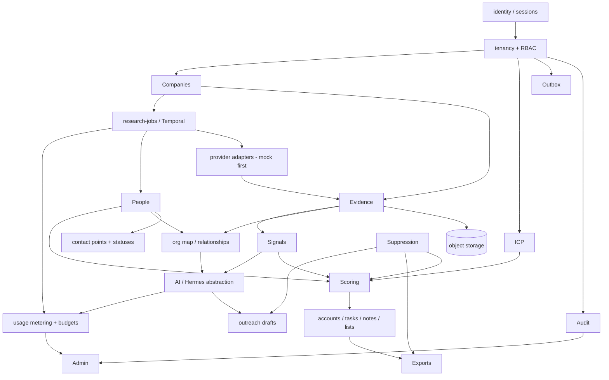

# Implementation Plan — B2B Lead Intelligence Platform ("Mapforce Revamped")

Status: **APPROVED for Phase 1** on 2026-10-11 (see §4.1 decision log)
Date: 2026-10-11
Remote: https://github.com/drmtraza/mapforce_revamped

This plan is derived from `README.md`, `docs/*`, `contracts/*`, `.cursor/rules/00-project.mdc`, `skills/b2b_org_deducer/SKILL.md` and `prompts/*`. It does not replace any documented requirement. Where artifacts conflict or are silent, the item is listed in §3 or §4 for owner decision rather than silently resolved.

---

## 1. Repository inspection report

| Item | Finding |
|---|---|
| Application code | None. The folder contains only the Cursor kit (docs, two JSON schemas, one rule file, one skill, prompts). |
| Git | Local folder is not a git repository. Remote `drmtraza/mapforce_revamped` exists and is empty (no refs). |
| Stray archive | `Murshad-LifePilot-deployed.tgz` was added by mistake and is not part of this app (confirmed by owner); removed. |
| Toolchain (local) | Node 24.11, npm 9.9, Python 3.14, uv 0.11, Docker 28.4 + Compose 2.39 (Docker Desktop **not running** at inspection time), git 2.51. Not installed: pnpm, GitHub CLI (`gh`). |
| Credentials | None assumed. All adapters default to deterministic mocks. |

### Assumptions made in this plan (override if wrong)
- A1. Single product team; TypeScript for control plane/web is acceptable (master prompt: "if consistent with the team's delivery plan").
- A2. Local development on Windows + Docker Desktop; CI on GitHub Actions (Linux).
- A3. Initial target is a managed container platform, not Kubernetes (README "Initial deployment posture").
- A4. No real contact data will ever be needed in dev/test; all fixtures use reserved domains (`*.example`, `*.test`) and synthetic names.
- A5. "Production ready" in the user brief means *production-grade engineering practice per phase*; production readiness and scale claims are only made after Phase 6 release gates (`QUALITY_AND_SCALE_PLAN.md` §6) pass with evidence.

---

## 2. Proposed stack and repository layout

### 2.1 Stack (recommended; see D1–D6 for approvals)
| Concern | Choice | Rationale / doc reference |
|---|---|---|
| Web | Next.js (App Router) + React + TypeScript strict, TanStack Query, accessible component primitives | ARCHITECTURE §2 Frontend |
| API / control plane | TypeScript + **Fastify**, Zod validation → OpenAPI generation, modular monolith | ARCHITECTURE §2, ADR-001 |
| DB access | **Kysely** (typed SQL builder) + plain-SQL migrations (`node-pg-migrate`) | Explicit SQL plays well with RLS + `SET LOCAL` tenant context; avoids ORM magic around tenant scoping |
| Database | PostgreSQL 16, RLS enabled on all tenant tables (defense in depth) | ADR-002, ARCHITECTURE §6 |
| Workflow | **Temporal** (dev server in Compose; Temporal Cloud or self-hosted later) | ADR-003, README |
| Workers | Python 3.12 (pinned in containers; uv-managed, mypy strict, ruff) for crawl/provider/AI activities | ARCHITECTURE §2 |
| Object storage | S3 API; MinIO locally | ARCHITECTURE §2 Storage |
| Cache / rate limits | Redis (non-durable roles only) | Rule: Redis not sole durable record |
| Events | Transactional outbox table → relay → Temporal signals / consumers; idempotent consumers | API_AND_EVENT_CONTRACTS |
| Graph | PostgreSQL `relationships` table; Neo4j deferred until benchmark | ADR-002 |
| Search | PostgreSQL full-text | DATA_MODEL Indexing |
| Observability | OpenTelemetry (traces/metrics), pino structured logs with correlation IDs; Python `structlog` | OPERATIONS §3 |
| Tests | Vitest (unit/integration via Testcontainers), Playwright (E2E + axe accessibility), pytest, k6 (load), schemathesis/OpenAPI contract tests | QUALITY §3 |
| CI | GitHub Actions: lint, typecheck, test, OpenAPI diff, gitleaks secret scan, dependency audit, container build + Trivy scan | OPERATIONS §2 |

**Key polyglot boundary decision (recommended):** Temporal workflows are written in TypeScript and run in a control-plane worker. Python workers execute *only* external-facing activities (discovery, crawl, provider calls, LLM) on their own task queues and **return normalized payloads**; they never write canonical tables. The TypeScript persistence activity validates every payload against JSON Schema/Zod and writes inside a tenant-scoped transaction with outbox rows. This gives one schema-validating writer to canonical truth, keeps DB credentials out of crawl containers (OPERATIONS §2), and satisfies "validate all AI/provider outputs before persistence".

### 2.2 Repository layout (monorepo)
```text
/
├─ apps/
│  ├─ web/                    # Next.js UI
│  └─ api/                    # Fastify modular monolith (HTTP + Temporal TS worker entrypoints)
│     └─ src/modules/
│        identity/ tenancy/ icp/ companies/ evidence/ people/ orgmap/
│        research-jobs/ signals/ scoring/ crm/ suppression/ exports/
│        usage/ audit/ admin/ outbox/
├─ workers/
│  └─ research/               # Python: adapters (mock first), crawler, AI/Hermes adapter
├─ packages/
│  ├─ contracts/              # JSON Schemas (from /contracts), generated TS types, event envelope
│  ├─ db/                     # SQL migrations, Kysely types, RLS policies, seed (synthetic only)
│  └─ config/                 # shared eslint/tsconfig/prettier
├─ contracts/                 # source-of-truth JSON Schemas (existing, versioned)
├─ docs/                      # existing docs + this plan + ADRs + runbooks
├─ infra/
│  ├─ docker/                 # Dockerfiles
│  └─ compose/                # docker-compose.yml (postgres, redis, minio, temporal, temporal-ui)
├─ tests/
│  ├─ e2e/                    # Playwright
│  └─ load/                   # k6 scripts (Phase 6)
├─ .github/workflows/         # CI
├─ .env.example               # placeholders only
└─ .cursor/ skills/ prompts/  # existing kit
```

---

## 3. Conflicts and gaps found in the artifacts

| # | Conflict / gap | Where | Proposed resolution (needs approval where marked) |
|---|---|---|---|
| C1 | `people`, `contact_points`, `claims`, `relationships`, `intent_signals` have **no `tenant_id`**, while the rule says every tenant-owned row is tenant-scoped and "never merge across tenant-private data without an explicit shared-data policy". `companies.tenant_id` is "nullable for global canonical entities" but the same section says use a separate global table. | DATA_MODEL | **D7**: MVP makes *all* entity tables tenant-scoped (`tenant_id NOT NULL`, RLS). A shared global company/person pool is deferred until a shared-data policy exists. |
| C2 | `org-map.schema.json` relationships have **no `rationale`**; master prompt requires "every inferred relationship and outreach hook must cite evidence IDs and include confidence plus rationale". `outreach_angle` is a bare string with no `evidence_ids`/`confidence`, contradicting AI_AGENT_SPEC. | contracts vs AI spec | **D8**: publish `org-map.schema.json` **v2** adding `rationale` (required) on relationships and making `outreach_angle` an object `{value, claim_type, confidence, evidence_ids, rationale}`. Breaking change → versioned `$id` and changelog. |
| C3 | Relationship predicates differ: org-map schema allows `WORKS_WITH`; AI spec allows only `REPORTS_TO|INFLUENCES|DECIDES_FOR`; PRD lists `WORKS_AT, HOLDS_ROLE, REPORTS_TO, INFLUENCES, DECIDES_FOR, USES_TECHNOLOGY, HIRING_FOR, EVIDENCED_BY`. | PRD / AI spec / schema | Canonical `relationships.predicate` enum = PRD list + `WORKS_WITH`. AI may only *propose* person→person `REPORTS_TO|INFLUENCES|DECIDES_FOR|WORKS_WITH`. Confirm in D8. |
| C4 | Relationship status: PRD has `verified, inferred, disputed, expired`; schema has no `expired`. | PRD / schema | DB enum includes `expired` (lifecycle); AI output may not emit `expired` or `verified` — only `inferred` (verification is a human/source action). Confirm in D8. |
| C5 | `claim_type` values: DATA_MODEL lacks `unknown`; lead schema and AI spec include it. | DATA_MODEL / contracts | `unknown` is an output-only marker; it is never persisted as a claim (absence of claim = unknown). No owner decision needed unless objected. |
| C6 | Master prompt email statuses omit `suppressed`; PRD + lead schema include it. | prompt / PRD | Keep `suppressed` (PRD is more specific; suppression overrides all). |
| C7 | Contradictory guidance on queues: "Temporal preferred" vs "BullMQ sufficient"; "select one". | README / ARCHITECTURE | **D3**: Temporal only. |
| C8 | Docs require "secure session/OIDC", rule requires "no credentials for local development". A hosted IdP (e.g. Clerk/Auth0) needs keys. | API contracts / rules | **D2**: IdP abstraction; local uses a credential-free dev OIDC provider in Compose. |
| C9 | No target geography → registry/procurement adapters undefined. | ARCHITECTURE §3 | **D10** (needed before Phase 2/3, not Phase 1). |
| C10 | `evidence_records.tenant_id nullable` (global evidence) conflicts with object-storage tenant isolation acceptance criterion. | DATA_MODEL / master prompt | Under D7, evidence is tenant-scoped; storage keys are `tenants/{tenant_id}/evidence/{evidence_id}`. |
| C11 | `lead.schema.json` has no `tenant_id`, `evidence` index or versioning; fine as an API output, but `$id` uses `example.invalid`. | contracts | Keep as API response contract; add `schema_version`. Change `$id` base when domain chosen (cosmetic). |

---

## 4. Decisions requiring owner approval

Recommended option is listed first. Phase 1 can start once D1–D8 and D11 are answered; D9–D10, D12–D13 are needed later.

| ID | Decision | Recommendation | Alternatives | Blocks |
|---|---|---|---|---|
| D1 | Control-plane language/framework | TypeScript + Fastify + Next.js | NestJS; Python FastAPI throughout | Phase 1 |
| D2 | Authentication | IdP adapter: **local = Keycloak dev realm in Compose (no external keys)**; production IdP chosen later (Clerk, Auth0, Cognito, Entra, or Keycloak hosted). Server-side httpOnly session cookie; no tokens in browser storage. | Clerk from day one (needs keys even locally); first-party auth | Phase 1 |
| D3 | Workflow engine | Temporal (TS workflows, Python activity workers) | BullMQ only | Phase 1 |
| D4 | DB access / migrations | Kysely + SQL migrations (node-pg-migrate) + RLS | Prisma; Drizzle | Phase 1 |
| D5 | Package manager | pnpm via Corepack (monorepo workspaces) | npm workspaces | Phase 1 |
| D6 | Python worker runtime | Python 3.12 pinned in containers, uv lockfile | 3.13 | Phase 1 |
| D7 | Tenancy model for entities | All entities tenant-private for MVP (resolves C1/C10) | Shared global entity pool + tenant overlays | Phase 1 |
| D8 | Contract changes | Approve org-map schema v2 (C2–C4) | Keep v1 and store rationale outside schema | Phase 1 (org map) |
| D9 | Hermes runtime | Model-provider abstraction with deterministic mock + one hosted model adapter; evaluate Hermes Agent runtime (self-hosted) in Phase 4 | Hermes-only | Phase 4 |
| D10 | Target geography/markets | Owner to specify (drives registry, procurement, privacy law: GDPR/UK GDPR/PECR/CAN-SPAM/PDPL, etc.) | — | Phase 2/3 |
| D11 | Git branching & push model | See §9: `main` protected; one branch per phase pushed and opened as a PR; merge after review | Push phases directly to `main` | Phase 0 push |
| D12 | Licensed contact provider + verification provider | Decide after procurement/terms review (Apollo is only an example in docs) | — | Phase 3 (adapter stays disabled) |
| D13 | Hosting cloud & managed services | Decide by Phase 6 (AWS/GCP/Azure; managed Postgres, Temporal Cloud vs self-host) | — | Phase 6 |

### 4.1 Decision log (owner responses, 2026-10-11)
| ID | Outcome |
|---|---|
| D1, D3, D4, D5, D6 | Approved as recommended: TypeScript + Fastify + Next.js; Temporal; Kysely + SQL migrations + RLS; pnpm monorepo; Python 3.12 workers with uv. |
| D2 | Approved: Keycloak dev realm locally behind an IdP adapter; production IdP chosen later. |
| D7 | Approved: all entity tables tenant-private for MVP. |
| D8 | Approved: `org-map.schema.json` v2 and `GET /evidence/{id}/content-url`. |
| D10 | Target markets: **United States, United Kingdom, European Union**. Implications: GDPR / UK GDPR + PECR / CAN-SPAM and US state privacy laws (e.g. CCPA/CPRA) drive purpose limitation, legitimate-interest assessment, suppression and deletion; candidate registries for Phase 2/3 evaluation include UK Companies House API, SEC EDGAR, OpenCorporates (licensed), EU national registries; procurement candidates include SAM.gov, UK Contracts Finder / Find a Tender, EU TED. All subject to terms review before enabling. |
| D11 | Phase branches pushed with a PR into `main`; Phase 1 starts from `phase-0/plan` without waiting for merge. |
| D9 | **Decided in Phase 4:** model-provider abstraction in the TypeScript control plane (so crawl workers never hold DB credentials). Deterministic mock is the default. Hermes HTTP adapter is compiled in but globally disabled until `FEATURE_HERMES=true` and `HERMES_BASE_URL` are set. Failed or ungrounded model output is quarantined and replaced by the deterministic fallback. |
| D14 (Phase 2) | Permitted search API: **Brave Search API**. Registered as `brave_search`, globally disabled and requiring `BRAVE_SEARCH_API_KEY` on the research worker; results become reviewable discovery candidates and are never auto-created as companies. Owner must review the provider terms before enabling. |
| D15 (Phase 2) | Public company-site crawler (`company_site`): **off by default per workspace; workspace owners/admins opt in** via source settings (audited). Bounded by robots.txt, SSRF guard, per-domain delay, page/byte budgets and a tenant daily page budget. |

---

## 5. Module dependency graph



Cross-cutting from Phase 1: tenant context propagation, correlation IDs, error contract, idempotency keys, audit, outbox.

---

## 6. Milestones (mapped to `DELIVERY_ROADMAP.md`) and git branches

| Phase | Branch | Scope (summary) | Exit criteria |
|---|---|---|---|
| 0 | `phase-0/plan` | This plan, ADR files, threat-model outline, repo baseline (`.gitignore`, `.editorconfig`, `.env.example`) | Owner approves plan + D1–D8, D11 |
| 1 | `phase-1/foundation-vertical-slice` | Monorepo, Compose, CI, auth (dev OIDC), tenants/RBAC, migrations + RLS, audit, outbox, OpenAPI + error contract, ICP (minimal), company intake, Temporal research workflow, mock adapter, evidence + MinIO, candidate person review, basic org map (relational), audit UI | §7 vertical slice passes; tenant A/B isolation suite passes across API, background job, object storage |
| 2 | `phase-2/discovery-evidence` | Source registry, adapter interface (all 6 methods), CSV import (dry-run, dedupe), one permitted search API adapter (flagged off), public site crawler with robots/SSRF/domain budgets, partial success, cancel, DLQ + replay | Provider failure isolated; provenance inspectable; SSRF suite passes |
| 3 | `phase-3/people-enrichment-signals` | Role history, entity resolution + merge/split review, contact status model, licensed provider adapter (disabled), budget-aware waterfall, careers/job-board signal adapter | No field labelled verified without method/source |
| 4 | `phase-4/ai-orgmap` | Model abstraction, Hermes adapter, skill wiring, strict schema validation + quarantine, evidence-ID validation, prompt-injection suite, budgets, deterministic fallback, labelled eval set | Eval thresholds met; unsupported claims surfaced |
| 5 | `phase-5/bd-workspace` | ICP builder v2, versioned explainable scoring (0–100), lists, ownership, tasks, notes, pipeline, suppression, controlled export (CSV formula-injection safe), drafts with human approval, usage/admin budgets | Suppression enforced across lists/exports/drafts; usage auditable |
| 6 | `phase-6/hardening-scale` | k6 load/soak, failure injection, tuning, pooling, dashboards, alerts, backup/restore drill, runbooks, security review | Published test report with workload, env, results, bottlenecks |
| 7 | `phase-7/controlled-rollout` | Beta tenants, synthetic monitoring, quota ramp | Per roadmap |
| 8 | `phase-8/review-refactor` | PRD/rules review, isolation hardening, staging/D13 blueprint | Highest-risk gaps fixed; remaining limits documented |
| 9 | `phase-9/deploy-packaging` | Compose app stack, smoke script, image healthchecks | Packaging dry-run documented; no vendor lock-in |

Each phase is delivered as small commits on its branch; each branch is pushed and a PR opened against `main`. A phase branch is created from `main` after the previous phase PR is merged.

---

## 7. Proposed Phase 1 vertical slice (first milestone)

### 7.1 User journey proven end-to-end
1. User signs in via dev OIDC (two seeded synthetic users: `alice@tenant-a.test`, `bob@tenant-b.test`).
2. User creates a workspace (tenant) and becomes `owner`.
3. User defines a minimal ICP (industries, countries, employee bands, target personas) — stored versioned.
4. User submits a domain (e.g. `acme.example`). Domain validated (syntax, public suffix, reserved/private blocked), quota checked, company upserted idempotently by normalized domain within tenant.
5. User launches research → `202 Accepted` with `job_id`, `status_url`. Temporal workflow `ResearchCompany` runs:
   - Python activity `mock_discovery.fetch_company_evidence` → deterministic evidence (seeded by domain hash) with source URL on `*.example`, `fetched_at`, `content_hash`, excerpt.
   - Python activity `mock_discovery.discover_people` → 2–4 synthetic candidates with role claims and evidence IDs; one deterministic mock source configured to fail to prove partial success.
   - TS activity `persist_research_result` → validates payload, writes `evidence_records` (+ normalized blob to `tenants/{tenant_id}/evidence/{id}.json.gz` in MinIO), `claims` (`provider_fact`), `people`, `employment_roles`, `relationships` (`WORKS_AT` verified-by-source; one `REPORTS_TO` as `inferred` only when mock evidence explicitly states it), `provider_usage`, outbox events, audit events — in one transaction.
6. UI shows company record, source evidence list (URL, provider, fetched time, hash, excerpt), per-source job outcomes (`partial_success`).
7. User reviews a candidate contact: sees each field's `claim_type`, confidence band with explanation, and evidence links; confirms/rejects/disputes → audit event.
8. User opens basic org map (relational query; verified edges solid, inferred edges dashed + labelled).
9. User opens audit trail: sign-in, workspace create, ICP create, company create, job start/finish, review action.

### 7.2 Tenant isolation proof (automated)
- API: Bob requesting Alice's company/evidence/job/person/org-map/audit IDs gets `404` (no existence oracle); list endpoints never include other-tenant rows.
- DB: RLS blocks reads when `app.tenant_id` unset or mismatched (tested with a raw connection using the app role).
- Background: workflow input carries `tenant_id`; persistence activity re-asserts the job's tenant and rejects mismatched payloads.
- Object storage: evidence download only through API (signed, short-TTL URL generated after authorization); keys are tenant-prefixed; test that Tenant B cannot obtain a URL for Tenant A's object.
- Export: not in Phase 1 (no export endpoint exists → nothing to leak); covered in Phase 5.

### 7.3 Phase 1 API surface (`/api/v1`)
`GET/POST /workspaces`, `GET /workspaces/{id}/members`, `GET/POST /icp-profiles`, `PATCH /icp-profiles/{id}`, `POST /companies`, `GET /companies`, `GET /companies/{id}`, `GET /companies/{id}/evidence`, `GET /evidence/{id}/content-url`, `POST /companies/{id}/research-jobs`, `GET /research-jobs/{id}`, `POST /research-jobs/{id}/cancel`, `GET /companies/{id}/people`, `GET /people/{id}`, `POST /people/{id}/review`, `GET /companies/{id}/org-map`, `GET /audit-events`, plus `/auth/*` session routes and `/healthz`, `/readyz`.
Note: `GET /evidence/{id}/content-url` is an **addition** to the documented surface (needed for safe object access) — flagged for approval with D8.

### 7.4 Explicitly out of Phase 1
CSV import, real crawler, real providers, AI/LLM, scoring beyond none, CRM, exports, billing, Neo4j, search engine, invitations email delivery.

---

## 8. Migration sequence

Migrations are forward-only SQL with documented rollback/forward-fix notes; each runs in CI against a fresh Postgres and against the previous release's schema.

> **As built in Phase 1:** tables are grouped into migrations 0001–0009 with RLS defined alongside each table, and `idempotency_keys` was dropped. See `PHASE_1_REPORT.md` §4 and §6 for the as-built sequence and all deviations (including RustFS replacing MinIO). Rows below 0009 remain the forward plan and will be renumbered when implemented.

| # | Migration | Phase |
|---|---|---|
| 0001 | extensions (`pgcrypto`, `citext`), app roles (`app_rw` without BYPASSRLS, `migrator`), `set_tenant()` helper | 1 |
| 0002 | `tenants`, `users`, `memberships` (unique `(tenant_id,user_id)`, role enum) | 1 |
| 0003 | `audit_events` (append-only; `UPDATE/DELETE` revoked from app role) | 1 |
| 0004 | `outbox_events`, `idempotency_keys` | 1 |
| 0005 | `icp_profiles` (versioned) | 1 |
| 0006 | `source_registry` (global reference, read-only to app), `companies` (unique `(tenant_id, primary_domain_normalized)`), `company_aliases`, `company_identifiers` | 1 |
| 0007 | `evidence_records`, `claims`, `claim_evidence` | 1 |
| 0008 | `people`, `person_aliases`, `employment_roles`, `person_company_links`, `person_reviews` | 1 |
| 0009 | `relationships` (+ `relationship_evidence`) | 1 |
| 0010 | `workflow_jobs`, `workflow_job_sources` (per-source outcome), `provider_usage` | 1 |
| 0011 | RLS policies + `FORCE ROW LEVEL SECURITY` on all tenant tables; composite indexes `(tenant_id, …)` | 1 |
| 0012 | `contact_points` (encrypted value, `normalized_value_hash`, status enum incl. `suppressed`), `consent_suppressions` | 3 (suppression table may land in 1 if cheap) |
| 0013 | `import_batches`, `import_rows`, `match_candidates` | 2–3 |
| 0014 | `intent_signals`, `signal_evidence` | 3 |
| 0015 | `ai_runs` (model, prompt version, evidence IDs, tokens, cost, validation outcome), `ai_quarantine` | 4 |
| 0016 | `score_runs`, scoring weight versions | 5 |
| 0017 | `account_assignments`, `tasks`, `notes`, `activity_events`, `lists`, `list_items`, `outreach_drafts`, `exports` | 5 |
| 0018 | usage plans/quotas/budgets, feature flags, kill switches | 5 |

As-built numbering diverged: Phase 2–4 consumed 0011–0012 under different names. Phase 5 lands as a single forward-only `0013_bd_workspace.sql` covering scoring policies/runs, accounts, lists, tasks, notes, export batches and tenant budget overrides. Phase 6 adds `0014_hardening.sql` (usage/export/pipeline indexes, `workspace_controls` kill switches). Billing/plan tables are not implemented.

---

## 9. Git / delivery workflow (pending D11)

1. `main`: initial commit = kit artifacts as provided (+ `.gitignore` excluding the stray `.tgz`, `.env*`, build outputs).
2. `phase-0/plan`: this plan + ADR stubs. Pushed; PR opened for owner review.
3. After approval and merge: `phase-1/foundation-vertical-slice` from `main`, small commits, CI green, pushed, PR.
4. Repeat per phase. Recommend enabling branch protection on `main` (require PR + passing CI).
5. `gh` CLI is not installed; pushes use git over HTTPS with Git Credential Manager. PRs can be opened via the GitHub web UI or after installing `gh`.

---

## 10. Test plan

| Layer | Phase 1 coverage | Later |
|---|---|---|
| Unit | domain normalization, URL/domain validation (private/reserved blocking), RBAC policy matrix, error contract, idempotency, confidence-band labelling, payload schema validation | scoring factors, suppression precedence, dedupe, freshness, retry policy |
| Integration (Testcontainers Postgres/MinIO, Temporal test env) | migrations up on clean DB, RLS enforcement, outbox write-in-transaction, research workflow incl. partial failure + retry bound + cancellation, object storage keying | provider adapters, deletion propagation, AI quarantine |
| Contract | OpenAPI generated + diffed in CI; JSON Schemas validated with Ajv (TS) and `jsonschema` (Py); mock adapter fixtures validate against adapter schema | real/mock adapter parity, event schema versions |
| Security | cross-tenant IDOR suite on every Phase 1 route, RBAC bypass, mass assignment, CSRF on cookie session, security headers, gitleaks | SSRF suite, CSV formula injection, prompt injection, rate-limit bypass |
| E2E (Playwright) | full §7.1 journey; tenant B cannot see tenant A via UI | import, scoring, drafts, export suppression, deletion |
| Accessibility | axe checks on Phase 1 pages (WCAG 2.2 AA target) | all key workflows |
| Load | none (no capacity claims) | Phase 6 k6 scenarios per QUALITY §3 |

Python: `ruff`, `ruff format`, `mypy --strict`, `pytest`. TypeScript: `eslint`, `prettier --check`, `tsc --noEmit` (strict), `vitest`. All run in CI; results reported verbatim per phase.

---

## 11. Acceptance criteria

### Phase 1 (must all pass, evidenced by test output)
1. Sign-in via dev OIDC; session cookie httpOnly/secure(in prod)/SameSite; no tokens in browser storage.
2. Workspace creation makes creator `owner`; RBAC matrix enforced server-side for all Phase 1 routes.
3. ICP create/update produces new version; previous version retained.
4. Submitting the same domain twice (or same `Idempotency-Key`) yields one company and one job.
5. Research job returns `202`, transitions through documented statuses, ends `partial_success` when the failing mock source fails; per-source outcomes visible.
6. Every persisted company/person/role claim has ≥1 `claim_evidence` row with source URL, provider, `fetched_at`, `content_hash`; inferred relationships stored as `inferred` with confidence + rationale + evidence IDs.
7. Invalid adapter payload is rejected and recorded (job source `failed`, reason code) — nothing written to canonical tables.
8. Candidate review (confirm/reject/dispute) persists and emits an audit event.
9. Org map distinguishes verified vs inferred edges in API and UI.
10. Audit trail lists all actions in §7.1 with actor, correlation ID, outcome.
11. Tenant isolation suite (§7.2) passes for API, DB RLS, background job, object storage.
12. Retries bounded (max attempts + timeouts configured on every activity); no unbounded loops.
13. CI green: lint, format, typecheck, unit, integration, contract, E2E, secret scan.
14. `docker compose up` + one seed command reproduces the demo with zero credentials.

Phases 2–7: acceptance criteria are the roadmap exit criteria (§6) plus PRD §7; each phase will expand them into testable checks in its own PR description before coding starts.

---

## 12. Risks

| Risk | Impact | Mitigation |
|---|---|---|
| Temporal + Keycloak + MinIO add local-dev weight on Windows | Slower onboarding | Single `docker compose up`; documented memory requirements; health checks |
| Polyglot (TS + Python) increases CI and contract-drift risk | Schema drift | Shared JSON Schemas in `contracts/` as single source; codegen types for both languages; contract tests in CI |
| Python 3.14 locally vs 3.12 pinned | Dependency incompatibility | Run workers in containers; `uv python pin 3.12` |
| Source/provider terms unknown (D10, D12) | Legal exposure, blocked adapters | Adapters ship disabled; source registry requires terms reference before enable |
| Hermes Agent runtime maturity / hosting cost | Phase 4 slip | Model abstraction + deterministic fallback; evaluate before committing |
| Scale targets (1M / 10K) unproven | Overclaiming | No claims until Phase 6 report; workload model defined first |
| RLS misconfiguration (e.g. app role with BYPASSRLS, missing `FORCE`) | Cross-tenant leak | Migration test asserts every tenant table has RLS forced; dedicated non-owner app role |
| Contact data privacy law varies by market | Compliance | D10 before any real provider; purpose limitation and suppression from day one |
| No `gh` CLI / push credentials | Delivery friction | Git Credential Manager over HTTPS; PRs via web UI |

---

## 13. Next step

Owner reviews §3 and §4. On approval of D1–D8 and D11, implementation of Phase 1 begins on `phase-1/foundation-vertical-slice` in small commits, each followed by format/lint/typecheck/test runs with results reported verbatim.

**Status:** Phase 1 implemented — see `PHASE_1_REPORT.md`. Phase 2 implemented on `phase-2/discovery-evidence` — see `PHASE_2_REPORT.md`. Phase 3 implemented on `phase-3/people-enrichment-signals` — see `PHASE_3_REPORT.md`. Phase 4 implemented on `phase-4/ai-orgmap` — see `PHASE_4_REPORT.md`. Phase 5 implemented on `phase-5/bd-workspace` — see `PHASE_5_REPORT.md`. Phase 6 implemented on `phase-6/hardening-scale` — see `PHASE_6_REPORT.md`. Phase 7 implemented on `phase-7/controlled-rollout` — see `PHASE_7_REPORT.md`. Phase 8 implemented on `phase-8/review-refactor` — see `PHASE_8_REPORT.md`. Phase 9 implemented on `phase-9/deploy-packaging` — see `PHASE_9_REPORT.md`. D12 remains open. D13 ADR still awaiting owner vendor choice. GA packaging is not a readiness claim.
